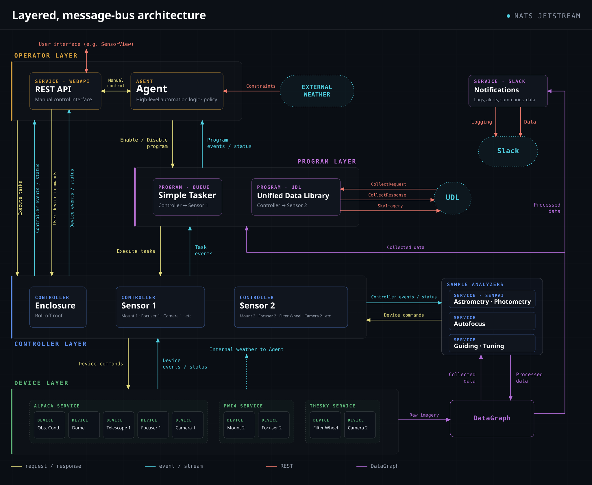

<h1 class="sk-hero">
  
  
</h1>

**SensorKit is an open-source control system for autonomous observatories**, built for space domain awareness and time-domain astronomy.
It connects telescope hardware to an automation agent that decides when to open the dome, which program to run, and when to shut down.
Observing programs select targets for satellite tracking, transient follow-up, or survey work.

Describe your devices, weather limits, and observing programs in a single YAML file.
The following excerpt connects a sensor to its devices and adds a weather constraint and an observing program.

```yaml
sensors:
  - id: MySensor
    model:
      components:
        - device: MyMount
        - device: MyDome
        - device: MyCamera
          instrument: true
    policies: {}

automation:
  controllers:
    MySensor:
      constraints:
        - kind: weather
          provider: MyWeather
          humidity_max: 85.0
          wind_max: 15.0
      tasking:
        - program: SatelliteSurvey
          priority: 5
```

## What it does

- **Autonomous operation.** An agent service evaluates operating modes (e.g. sunset to sunrise), weather and safety constraints, and program schedules — then starts up, tasks, and shuts down each sensor on its own. A single command hands control back to a human.
- **Speaks your hardware's language.** Drivers for ASCOM Alpaca, PlaneWave PWI4, and Software Bisque TheSky are included, with additional modules for INDIGO, NINA, and the Observable Space Node Platform. If your device has one of these interfaces, SensorKit can probably run it today.
- **Satellite tracking as a first-class citizen.** Targets can be fixed alt/az or ICRS positions, TLEs, state vectors, or precomputed ephemerides. SensorKit propagates orbits (via `satkit` and `astropy`) and drives mounts in rate-tracking modes for fast-moving objects.
- **Observing programs in a few dozen lines of Python.** A program is a small class that advertises *when* it has work and produces the *next task* when asked. Everything else — scheduling, priorities, device sequencing, FITS writing — is handled for you.
- **Configuration-defined data flow.** Camera frames move through a pipeline you declare in YAML: inject FITS headers populated from live telescope state, compress, write to disk, or hand off to analysis services for astrometry, photometry, or focus estimation.
- **Built to be pulled apart.** Every device driver, sensor controller, program, and the agent itself is an independent service communicating over [NATS JetStream](https://nats.io). Services can run on different machines, restart without disturbing each other, and be swapped out without touching the rest of the system.

## How it fits together



- **Devices** wrap hardware drivers and expose commands and telemetry on the bus.
- The **sensor controller** coordinates devices and instruments, with configurable initialization, shutdown sequencing, and command timeouts.
- **Programs** publish *offer windows* ("I have work between these times") and produce tasks on demand.
- The **agent** combines modes and program offers into a schedule, applies safety constraints, and brings controllers up and down accordingly.
  After a restart, it restores control settings and checks controller state before resuming operation.

A few design choices worth knowing about, because they shape day-to-day use:

- **Devices are described by what they can do, not what they're called.** A structural *trait* system matches devices by the commands they implement, so a controller asks for "something that can slew and track" rather than a specific driver class.
- **State is event-sourced.** Stored state is rebuilt from persisted events after a restart.
  Controllers verify or reestablish their operating state before accepting observation tasks.
- **Exclusive leases** prevent two copies of the same service from fighting over one piece of hardware.

## Status

SensorKit is in **beta** and under active development. It runs real telescopes nightly, but APIs and configuration formats are still evolving, and some corners are unfinished (module maturity varies — ASCOM Alpaca and PWI4 are the most exercised paths). Feedback and issues are very welcome.

## Where to start

|                                     |                                                                        |
|-------------------------------------|------------------------------------------------------------------------|
| [Quick start](quickstart.md)        | Run a complete simulated observatory with Docker in about ten minutes   |
| [Installation](installation.md)     | Install SensorKit, start NATS, and launch services                     |
| [Configuration](configuration.md)   | The unified `sensorkit.yaml` file, data flow, and the KV store         |
| [Device services](devices.md)       | Connect ASCOM Alpaca, PWI4, TheSky, and Node Platform hardware         |
| [Sensor controller](sensor.md)      | Coordinate devices into an instrument; run tasks manually              |
| [Observing programs](programs.md)   | Write a program that feeds targets to your telescope                   |
| [The agent](agent.md)               | Modes, constraints, scheduling, and autonomous control                 |
| [CLI reference](cli.md)             | Every `sensorkit` command                                              |
| [API reference](api.md)             | The `sensorkit.api` Python surface                                     |
